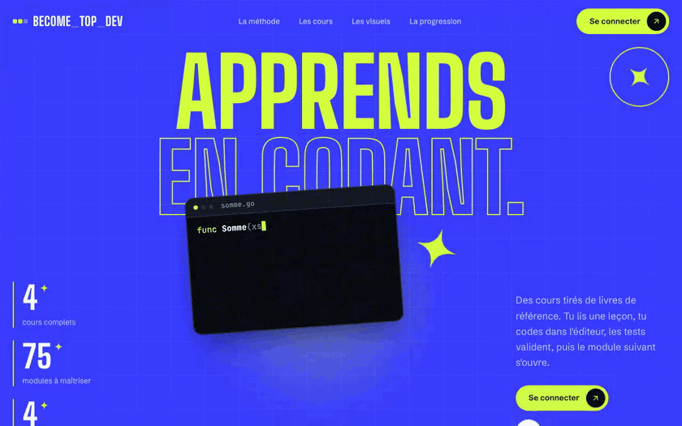
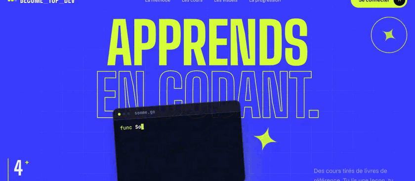
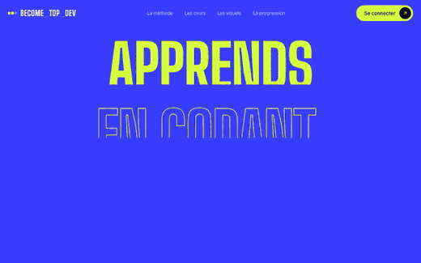
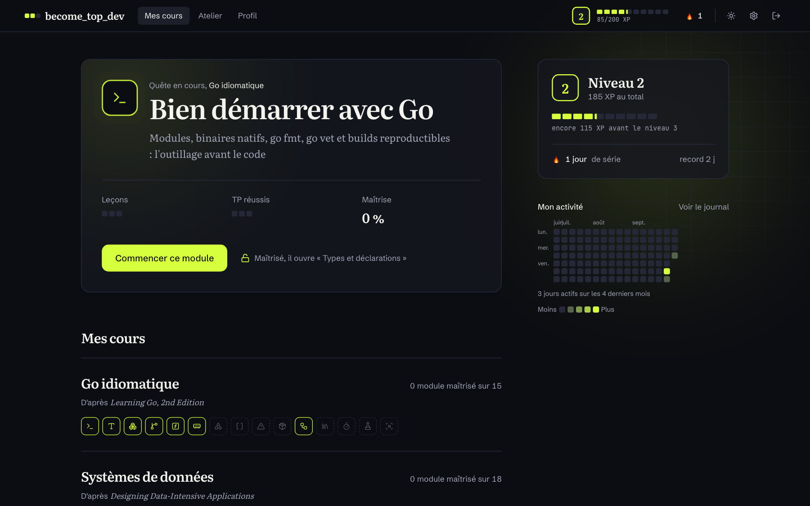
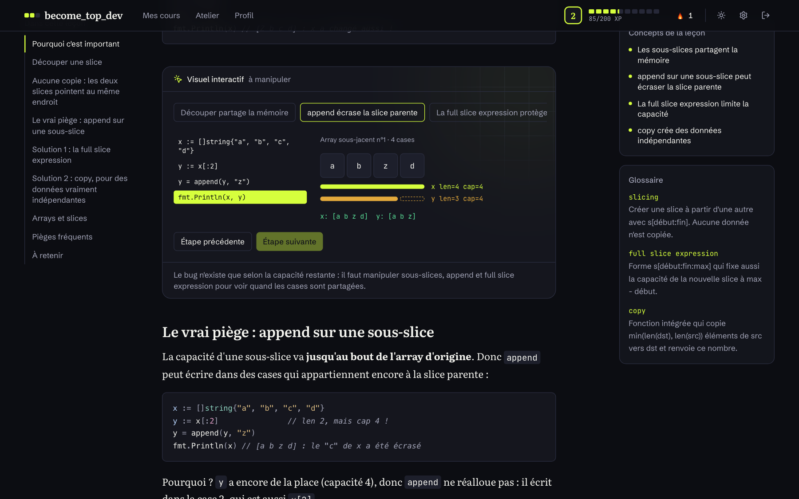
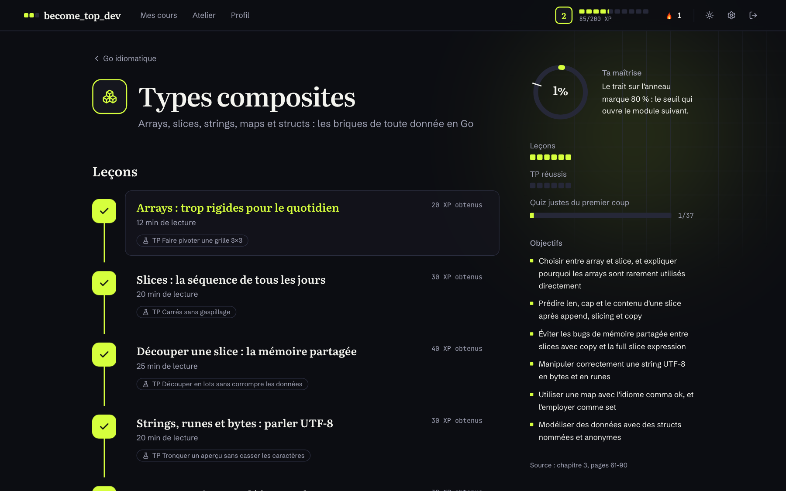
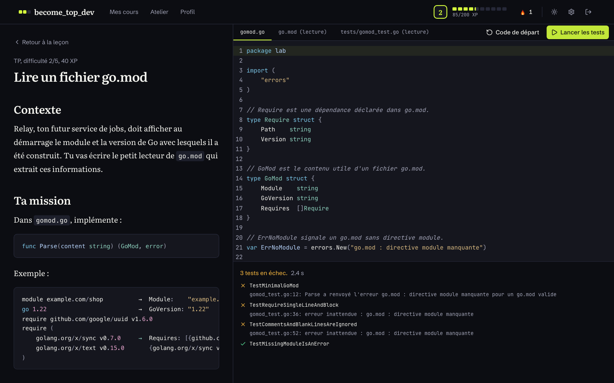
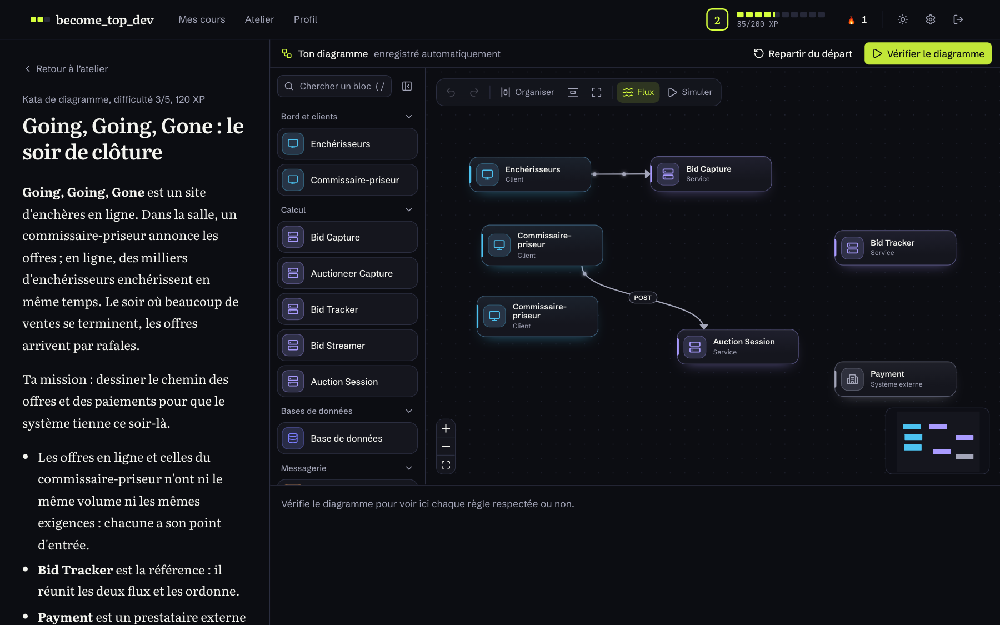
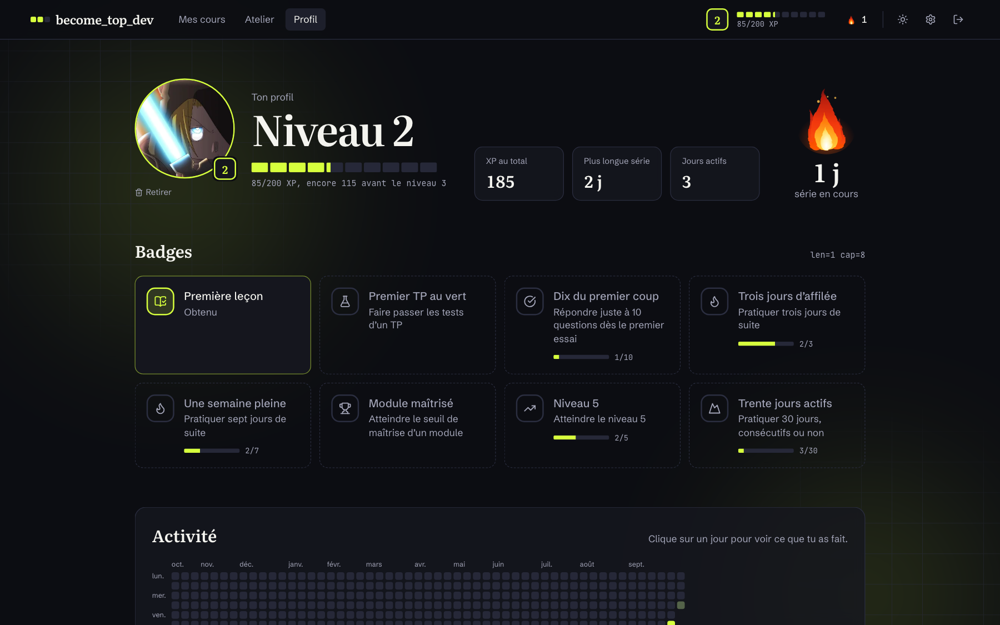
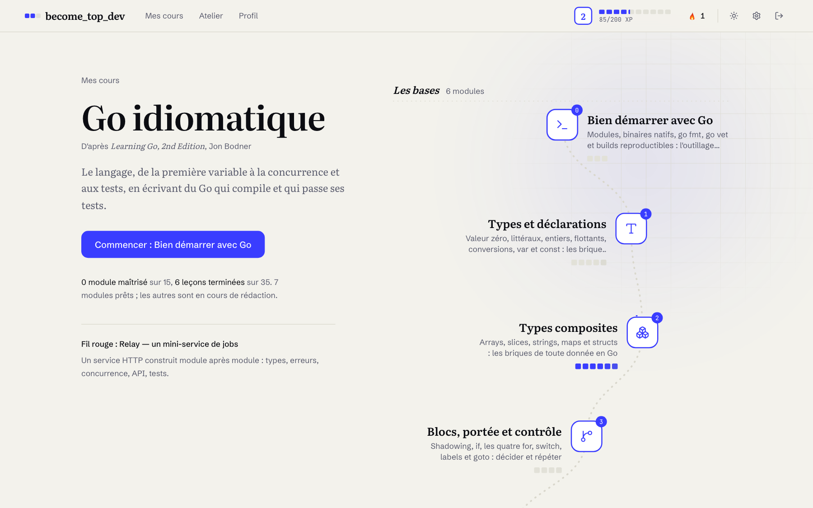

# become_top_dev

A personal platform for learning to code deeply, in the spirit of boot.dev, with more depth and a more careful design. Courses are built from reference books. Each one comes with lessons, sandbox-tested labs, quizzes, flashcards, projects, boss fights and XP.

Invite-only, for a handful of learners. One goal: become a top 1% developer.

<p align="center">
  
</p>

## Highlights

- **Courses written from books, not copied from them.** An agent reads each book in full, then rewrites it as lessons with page references. There are no long excerpts.
- **Every lab is verified.** A lab ships only if its reference solution passes the tests *and* its starter code fails them.
- **Real code execution.** Go code runs in a throwaway Docker container with no network, capped CPU, memory, pids and time, and a read-only filesystem.
- **Non-code exercises are graded too.** Architecture katas (diagrams, ADRs) are scored against a rubric rule by rule, each rule saying what is missing.
- **Progression that matters.** XP, levels, streaks, an activity graph, and modules that unlock only once the previous one is mastered (80%).
- **Invite-only accounts.** Email and password sign-up with a single-use invite code created by the admin. Each learner keeps their own progress.
- **Poster-style design.** Ink, lime and electric blue, shared by the landing page and the whole app. Dark by default, light theme available (blue takes over the accent there), desktop-first.

## Landing page

A poster in ink, lime and electric blue. Headlines rise word by word, two marquees cross under the hero, and each step of the method has its own looping HyperFrames illustration.

<p align="center">
  
</p>

<p align="center">
  
</p>

## Tour

### Dashboard

The current quest, level, streak and activity graph, then every course with its modules.

<p align="center">
  
</p>

### Lessons

Long-form reading with a table of contents, a glossary, key concepts and the book pages each lesson comes from. Interactive and animated visuals explain the hard concepts, step by step.

<p align="center">
  
</p>

### Chapters

Each chapter is a path of lessons with their labs, XP, mastery ring, objectives and first-try quiz score.

<p align="center">
  
</p>

### Code labs

A CodeMirror editor next to the brief. Tests run in the sandbox and report per-test results with precise failure messages.

<p align="center">
  
</p>

### Architecture katas

Conceptual exercises are drawn on a canvas (React Flow) and checked against a rubric.

<p align="center">
  
</p>

### Profile

Level, total XP, streaks, badges with their progress, and a year of activity.

<p align="center">
  
</p>

### Light theme

Warm paper instead of ink; electric blue takes over the accent.

<p align="center">
  
</p>

## Courses

| Course | Book | Exercises | Status |
|---|---|---|---|
| `go`: Idiomatic Go | *Learning Go, 2nd ed.* (Bodner) | Go labs, tested | 7 of 15 modules ready |
| `ddia`: Data systems | *Designing Data-Intensive Applications* (Kleppmann) | Go labs, running project "Tinybase" | 11 of 18 modules ready |
| `grails`: Groovy & Grails | *Programming Grails* + *Groovy in Action, 2nd ed.* | Groovy 4 / JDK 17 labs, targeting Grails 7 | 2 of 23 modules ready |
| `arch`: Software architect | *Fundamentals of Software Architecture* (Richards & Ford) | katas, ADRs and diagrams, graded by rubric | 20 modules planned, first kata available in the workshop |

Course content is generated ahead of time, versioned in `content/`, and loaded by the app. Books and their text extractions (`books/`, `.cache/`) are never committed.

## Architecture

```
 Browser ──► Caddy ──┬──► Frontend (TanStack Start)
                     └──► Backend (Go) ──► PostgreSQL
                              │
                              ▼
                       Runner (Go) ──► Docker: one throwaway container per run
```

- **Backend**: Go (`net/http`), PostgreSQL via pgx with hand-written SQL, goose migrations. Layered monolith: `internal/api → service → repository → model`. PostgreSQL stores accounts and user state only (XP, attempts, progress), keyed by user; content stays in files. Passwords are hashed with argon2id; sessions live in the database (the cookie holds a random token, the database its SHA-256).
- **Runner**: a separate Go service using only the standard library. It is the only component that talks to Docker, so the backend never touches the Docker socket.
- **Frontend**: TanStack Start (React), shadcn/ui, Tailwind, CodeMirror 6, React Flow, Motion for UI animation, `@remotion/player` and HyperFrames for visuals. Colors are tokens in `frontend/src/styles/app.css`; HyperFrames scenes reuse the same values.
- **Deployment**: Docker Compose on Coolify, Caddy as reverse proxy.

```
content/<book>/     generated courses (source of truth for content)
backend/            Go API (XP, attempts, progress)
runner/             sandboxed code execution
frontend/           TanStack Start app
sandbox/images/     Docker images for the runners
deploy/             Caddyfile and proxy image
scripts/            dev.sh, validate_content.sh
docs/screenshots/   README images
```

## Getting started

Requirements: Docker, Go, Node and pnpm.

```bash
make dev
```

This starts PostgreSQL (Docker, port 5433), the runner (:8001), the backend (:8000) and the frontend at http://localhost:3000. Development account: `dev@btd.local` / `dev`.

## Commands

| Command | Purpose |
|---|---|
| `make dev` | Run everything locally |
| `make test` | Backend and runner tests, frontend type check |
| `make lint` | gofmt and go vet (backend, runner) |
| `make validate-content` | Replay every lab (solution passes, starter fails) and every code-output quiz |
| `make up` / `make down` | Full stack with Docker Compose |
| `make reset-progress` | Reset local progress (all accounts) |
| `cd backend && go run ./cmd/btd reset-password <email>` | Set a new password (read from stdin) and close the account's sessions |

## Deployment (Coolify)

1. Create `.env` from `.env.example` and replace every value. Set `SECURE_COOKIES=true` behind HTTPS. `ADMIN_EMAIL` / `ADMIN_PASSWORD` create the owner account on first start, then are ignored; the admin creates invite codes from the settings page.
2. Deploy `docker-compose.yaml` and point your domain at the `proxy` service (port 80). Caddy sends `/api/*` to the backend and everything else to the frontend.
3. PostgreSQL is external to the stack: the backend connects through `DATABASE_URL`.

The `runner` mounts the host Docker socket. Never expose it publicly.

## Contributing content

The full workflow (read the book, plan, generate chapter by chapter) and the quality rules are in [AGENTS.md](AGENTS.md). Key rule: a lab is delivered only when `verify_lab.sh` passes.

The app's UI and course content are in French. Code, identifiers and paths are in English.
